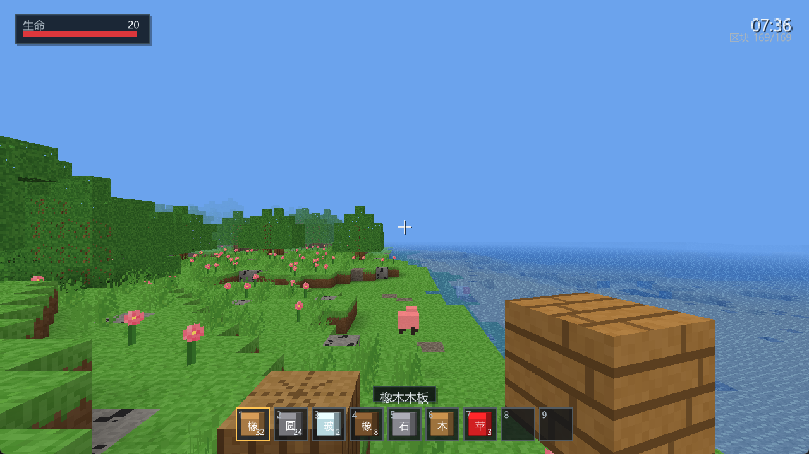
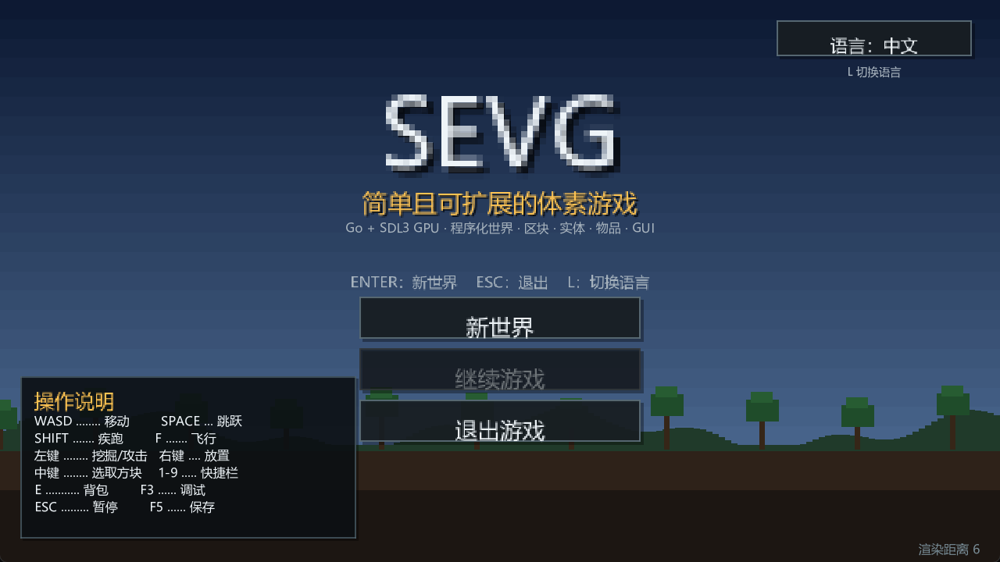
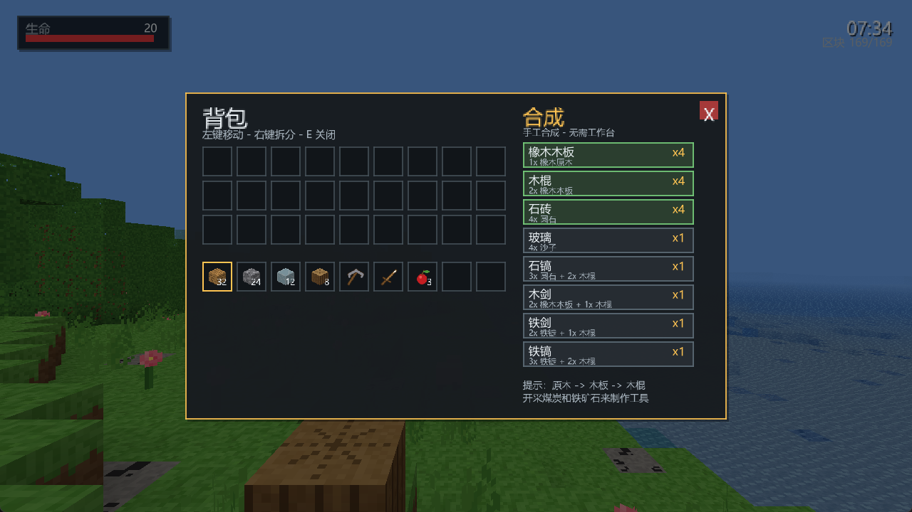
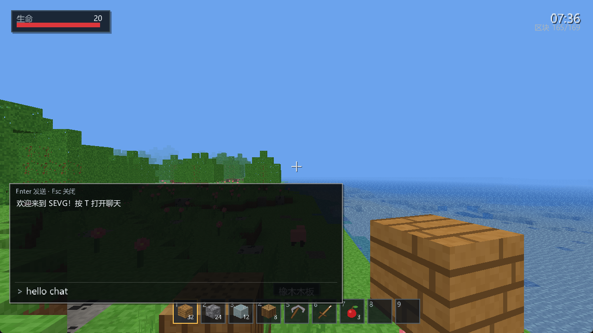
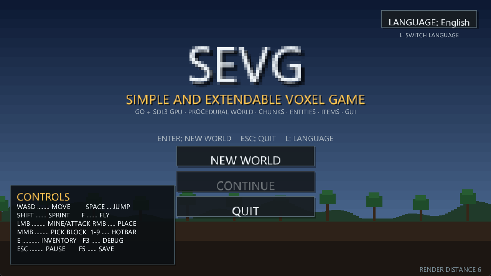
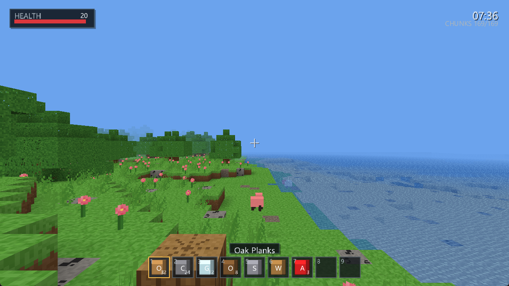

# SEVG

**Simple and Extendable Voxel Game** — 一个使用 **Go + SDL3 GPU** 从零实现的体素沙盒游戏。



SEVG 的目标不是复刻完整的 Minecraft，而是提供一个 **结构清晰、便于扩展** 的体素游戏基础：世界生成、区块流式加载、面剔除、环境光遮蔽、程序化材质、玩家物理、物品/背包/合成、实体 AI、掉落物、完整 GUI、存档系统，以及一条可用的 SDL3 GPU 渲染管线。

---

## 功能

### 世界

- 无限（按需流式加载）体素世界，区块大小 **16 × 16 × 128**
- 基于种子的 Perlin/fBm 噪声地形
- 生物群系：平原、森林、沙漠、雪原、山地、海洋
- 洞穴、煤矿、铁矿、沙砾矿脉
- 橡树、仙人掌、花、高草
- 水位、海洋和沙滩
- 出生点安全检测与小型出生地清理
- 区块后台生成（2 个工作协程）与按距离卸载
- 区块编辑会持久化到存档

### 渲染

- **SDL3 GPU API**（Vulkan 后端 / SPIR-V）
- 区块级顶点/索引缓冲
- 为每个区块构建 18 × 18 的邻域快照，用于面剔除和 AO
- 环境光遮蔽、方向面明暗、距离雾
- 程序化 8 × 8 材质图集（16 px 贴图 + 4 px 防渗色边距），无外部图片资源
- 水/玻璃/冰使用透明通道，水面从远到近排序
- 深度纹理、窗口缩放、高 DPI 鼠标坐标换算
- 第一人称手持物品使用独立清空深度缓冲的视图模型通道，始终位于世界之上，同时保持自身前后遮挡
- 显式启用 VSync，FPS 采用 0.5 秒窗口按“帧数 / 实际耗时”计算，并显示平均帧时间
- 流式区块每帧最多重网格并上传一个，避免一次创建多个 GPU 缓冲造成卡顿
- 内置 7 × 13 位图字体与即时模式 GUI 画布

### 玩家

- 第一人称相机、鼠标视角
- AABB 方块碰撞、重力、跳跃、疾跑、游泳、飞行
- 生存模式 / 创造模式，可通过 `/gamemode 0|1` 切换
- 生命值、坠落伤害、死亡与重生
- 长按挖掘（方块硬度 + 手持工具速度）
- 右键放置方块 / 进食
- 中键选取方块
- 方块目标高亮
- 第一人称手持物品：方块/植物/玻璃使用 3D 视图模型；工具、食物和材料使用与背包同一图标生成的有厚度卡片模型
- 1–9 快捷栏、滚轮切换

### 物品与合成

- 方块物品、材料、工具、食物
- 36 格背包（9 格快捷栏 + 27 格背包）
- 堆叠、拆分、交换、拾取
- 羊毛方块、煤矿、铁锭、铁剑、铁镐
- 手工合成（不需要工作台）：
  - 原木 → 木板
  - 木板 → 木棍
  - 圆石 → 石砖
  - 沙子 → 玻璃
  - 圆石 + 木棍 → 石镐
  - 木板 + 木棍 → 木剑
  - 铁锭 + 木棍 → 铁剑 / 铁镐

### 实体

- 猪、羊，带有游荡 AI、重力、跳跃和碰撞
- 实体受击闪白、击退、生命值和死亡掉落
- 物品掉落物：弹跳、浮动、靠近玩家自动拾取
- 方块掉落物使用与放置方块一致的逐面贴图；高草/花使用十字模型；剑与镐使用小型 3D 模型；玻璃/冰掉落物保持透明
- 实体与地形共用深度/雾/光照管线

### 多语言

- 默认语言：**简体中文**
- 内置 **English**，可在主菜单点击语言按钮，或按 `L` 即时切换
- 方块名、物品名、生物群系、按钮、提示、背包/合成、暂停/死亡界面、调试信息均已本地化
- 语言随存档保存，也可以通过 `-lang en-US` 或 `-lang zh-CN` 启动
- 中文使用系统 CJK 字体（Windows 微软雅黑、Linux Noto CJK、macOS 苹方）；可用 `SEVG_FONT` 指定字体文件
- 字体图集在启动时按当前所有翻译字符生成，切换语言无需重启

### GUI

- 标题界面（程序化像素风背景）
- 暂停菜单
- 背包 + 合成界面
- 聊天栏：T/Enter 打开，支持中文 IME、输入、发送与最近消息记录
- 聊天指令：`/gamemode 0` 生存模式，`/gamemode 1` 创造模式
- 按 `/` 直接打开指令聊天，和 Minecraft 一致
- 生命条、快捷栏、物品名称、准星、挖掘进度
- 背包/快捷栏物品图标：方块等距贴图、植物贴图、工具与材料程序化图标
- F3 调试信息
- 多语言标题、暂停、背包、提示与调试文本
- 水下屏幕染色
- 死亡界面
- 提示 Toast、区块生成进度

### 存档

- Gob 二进制存档（默认 `savegame.gob`）
- 保存种子、时间、玩家位置/朝向/生命、背包、方块编辑
- F5 手动保存、30 秒自动保存、退出时保存
- 主菜单“继续”读取存档
- 支持 `-continue` 直接读取存档启动

---

## 截图

| 中文主菜单 | 中文背包与合成 |
| --- | --- |
|  |  |

| 中文聊天栏 | |
| --- | --- |
|  | |

| English menu | English in-game |
| --- | --- |
|  |  |

---

## 构建与运行

### 环境

- Go **1.27+**（开发环境为 Go 1.27.2）
- Python **3.10+**（仅用于开发脚本，游戏本身不需要 Python）
- 64 位 Windows / Linux / macOS
- 支持 **Vulkan** 的 GPU 与驱动（当前渲染器只打包了 SPIR-V 着色器）
- 中文字体：Windows 自带微软雅黑即可；Linux 建议安装 Noto Sans CJK；macOS 自带苹方
- 不需要 CGo、GCC 或手动安装 SDL3

SDL3 通过 `github.com/Zyko0/go-sdl3/bin/binsdl` 内嵌并在运行时释放；首次运行会略微慢一点。

```powershell
go mod tidy
go build -o sevg.exe .
.\sevg.exe
```

或者直接：

```powershell
go run .
```

快捷脚本（Windows 使用 `py`；Linux/macOS 使用 `python3`）：

```powershell
py build.py
py run.py
py test.py
```

也可以给脚本传游戏参数：

```powershell
py run.py -seed 12345 -renderdist 8
```

### 命令行参数

| 参数 | 默认值 | 说明 |
| --- | --- | --- |
| `-width` | `1280` | 窗口宽度 |
| `-height` | `720` | 窗口高度 |
| `-seed` | `0` | 世界种子；0 表示随机 |
| `-renderdist` | `6` | 区块渲染距离（半径） |
| `-save` | `savegame.gob` | 存档路径 |
| `-continue` | `false` | 启动时读取存档 |
| `-smoke` | `0` | 渲染 N 帧后退出，用于 CI/冒烟测试 |
| `-lang` | `zh-CN` | UI 语言：`zh-CN` 或 `en-US` |

示例：

```powershell
.\sevg.exe -seed 12345 -renderdist 8
.\sevg.exe -continue -save mysave.gob
.\sevg.exe -smoke 120 -seed 1
```

---

## 操作

| 按键 | 功能 |
| --- | --- |
| `W A S D` | 移动 |
| `Space` | 跳跃 / 上浮 |
| `Shift` | 疾跑 |
| `Ctrl` | 飞行下降 |
| 鼠标移动 | 视角 |
| 左键 | 挖掘 / 攻击（按住） |
| 右键 | 放置 / 进食 |
| 中键 | 选取准星所指方块 |
| `1`–`9` / 滚轮 | 切换快捷栏 |
| `E` | 背包与合成 |
| `T` / `Enter` | 打开聊天栏 |
| `/` | 打开聊天栏并预填 `/` 指令前缀 |
| `Enter` | 发送聊天消息 |
| `Ctrl+V` | 粘贴聊天内容 |
| 滚轮 | 聊天栏打开时翻阅历史消息 |
| 双击 `Space` | 飞行开关（仅创造模式） |
| `F3` | 调试信息 |
| `L` | 切换语言（中文 / English） |
| `H` | 显示/隐藏快速帮助 |
| `F5` | 保存 |
| `F11` | 全屏 |
| `Q` | 丢出当前物品 |
| `Esc` | 关闭聊天 / 暂停 |
| `Enter` | 主菜单开始新世界 |

### 游戏模式与指令

| 指令 | 功能 |
| --- | --- |
| `/gamemode 0` | 切换为生存模式 |
| `/gamemode 1` | 切换为创造模式 |
| `/help` | 显示可用指令 |

- **生存模式**：正常挖掘速度、方块掉落、放置消耗物品、受到坠落伤害
- **创造模式**：瞬间破坏方块、无掉落、放置不消耗物品、免疫伤害，双击 `Space` 飞行，并隐藏生命条与物品数量

---

## 项目结构

```text
.
├── main.go                     # 命令行入口
├── internal/
│   ├── mathx/                  # Vec3 / Mat4 / 投影与 LookAt
│   ├── core/                   # 方块、物品、背包、配方数据
│   ├── world/
│   │   ├── noise.go            # 种子化 Perlin / fBm
│   │   ├── generator.go        # 地形、生物群系、洞穴、矿脉、植被
│   │   ├── chunk.go / world.go # 区块容器、编辑、存档记录、流式查询
│   │   ├── mesh.go             # 面剔除、AO、材质 UV、区块网格
│   │   └── ray.go              # DDA 体素射线与 AABB 射线
│   ├── physics/                # AABB 碰撞与移动
│   ├── player/                 # 玩家控制、生命、坠落、飞行
│   ├── entity/                 # 猪/羊 AI、物品掉落、攻击拾取
│   ├── render/
│   │   ├── renderer.go         # SDL_GPU 设备、管线、缓冲、绘制
│   │   ├── atlas.go            # 程序化方块材质图集
│   │   └── shaders/            # GLSL + 预编译 SPIR-V
│   ├── i18n/                   # 多语言文本、方块/物品/群系名称
│   ├── ui/                     # CJK 系统字体图集与 2D 画布
│   └── game/                   # 游戏循环、输入、HUD、菜单、存档、流式调度、语言切换
├── cmd/atlasdump/              # 可选：导出材质图集 PNG
├── docs/                       # 截图
├── build.py / run.py / test.py # Python 开发脚本
├── shaders.py                  # 重新编译 GLSL → SPIR-V
└── dev.py                      # 脚本共用的 Go/glslang 查找逻辑
```

---

## 渲染管线概要

1. `CreateGPUDevice(GPU_SHADERFORMAT_SPIRV, ...)` 创建 Vulkan 后端。
2. 创建交换链颜色目标 + `D32_FLOAT` 深度目标。
3. 上传程序化材质图集与字体图集。
4. 每个脏区块在 CPU 上生成 `world.MeshData`，再通过传输缓冲上传为 GPU 顶点/索引缓冲。
5. 主渲染通道：
   - 不透明区块（深度测试 + 深度写入）
   - 实体/掉落物/方块高亮（复用方块图集管线）
   - 透明区块（关闭深度写入，按距离从远到近排序）
6. 手持物品通道：方块/植物在清空深度后以视图模型绘制，玻璃/冰使用透明混合且关闭深度写入；工具、食物和材料使用 UI 图标纹理生成有厚度的 3D 卡片。
7. UI 通道：无深度、Alpha 混合，绘制字体与面板。
8. 提交命令缓冲。

坐标约定：右手系、Y 向上，投影深度映射到 `[0, 1]`（SDL_GPU/Vulkan 约定）。

### 着色器

预编译的 `.spv` 已提交并嵌入二进制。修改 GLSL 后重新生成：

```powershell
py shaders.py
```

需要 [glslang](https://github.com/KhronosGroup/glslang/releases) 的 `glslang.exe`。脚本会优先使用 `PATH` / `GLSLANG`，其次使用 `.tools/glslang/bin/` 下的 `glslang`。

---

## 扩展指南

### 添加一个方块

1. 在 `internal/core/core.go` 添加 `BlockID` 常量、`BlockDefs` 条目和对应 `ItemID`。
2. 在 `internal/render/atlas.go` 添加程序化贴图（或复用现有 tile）。
3. 在 `internal/core` 的 `init` 中把方块映射到物品。
4. 重新编译即可；网格、碰撞、掉落、存档会自动支持。

### 添加一个物品/配方

- 在 `ItemDefs` 注册物品，设置 `Kind`、`MaxStack`、`Block`、`Mining`、`Damage`、`Food`。
- 在 `internal/game/interact.go` 的 `recipes` 中添加配方。
- GUI 会自动显示配方与数量。

### 添加一个实体

- 在 `internal/entity` 添加 `Kind`。
- 在 `Boxes()` 中组合若干 AABB 部件。
- 复用 `physics.Body` 与 `Manager` 的生成、更新、掉落逻辑。

### 添加语言/文本

- 在 `internal/i18n/i18n.go` 的 `translations` 中添加 `zh-CN` / `en-US` 键值。
- 方块/物品名称在 `zhBlockNames` / `zhItemNames` 中维护。
- 新增文本后 `i18n.AllRunes()` 会自动收集字符，启动时重新生成字体图集。
- UI 中使用 `i18n.T("key")`；内容名称使用 `i18n.ItemName` / `i18n.BlockName` / `i18n.BiomeName`。

### 添加 GUI 页面

- 使用 `ui.Canvas` 的 `Rect`/`Panel`/`Text`/`drawItemIcon`。
- 在 `Game.drawUI` 中根据 `State` 分发。
- 点击布局集中在 `internal/game/hud.go` 的 `*Rects()` 方法中。

---

## 测试

```powershell
go test ./...
```

包含：

- 噪声确定性/范围
- 区块生成确定性、网格世界坐标
- DDA 射线命中
- 方块编辑持久化
- 安全出生点
- 背包堆叠/移除
- 投影矩阵深度映射
- AABB 落地碰撞
- 挖掘掉落、放置消耗
- 存档往返、合成
- 实体射线拾取

冒烟测试：

```powershell
.\sevg.exe -smoke 120 -seed 12345
```

---

## 已知限制 / 后续方向

- 当前只提供 SPIR-V 着色器，因此需要 Vulkan 后端；D3D12/Metal 需要增加 DXIL/MSL 着色器变体。
- 没有音频、多人联机、红石、流体模拟、光照传播（火把/熔炉）。
- 没有工具耐久、饥饿、经验、附魔、工作台方块。
- 生物只有猪和羊，AI 为游荡型。
- 存档保存方块编辑，而不是完整区块；地形由种子重新生成。
- 当前区块生成在写锁内完成，极端低端机器可能出现轻微卡顿；下一步可改为“生成 → 提交”的无锁流水线。

---

## License

MIT。见 [LICENSE](LICENSE)。